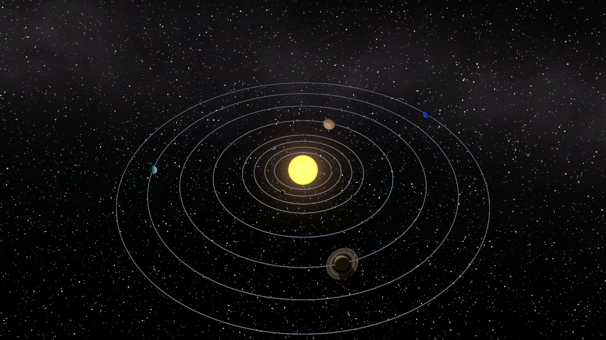
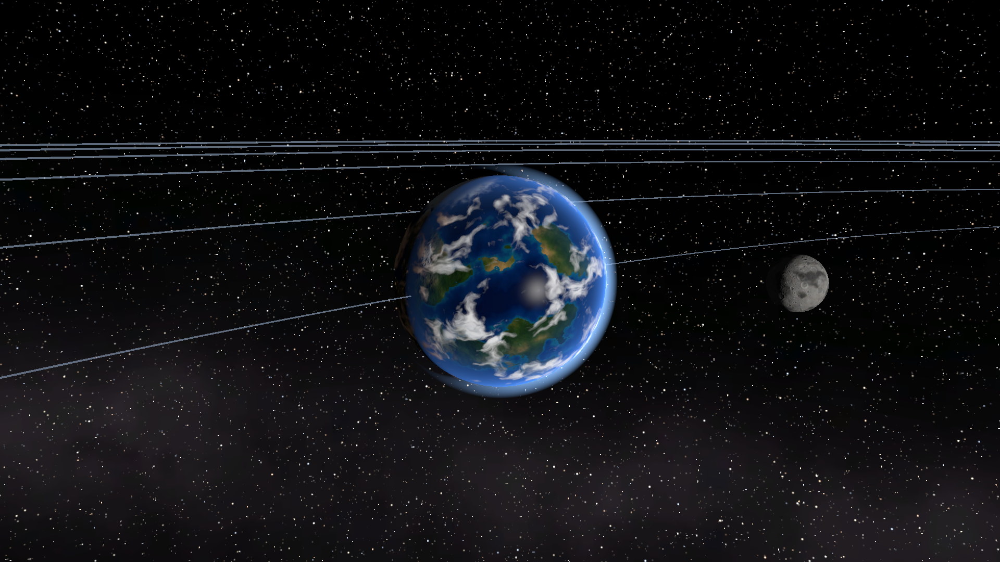
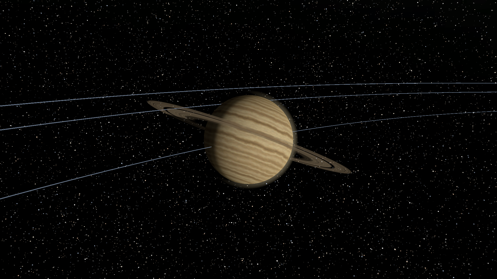
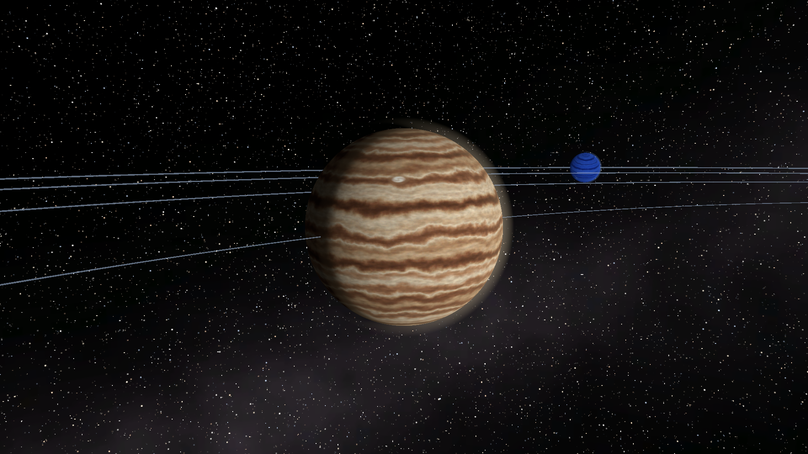
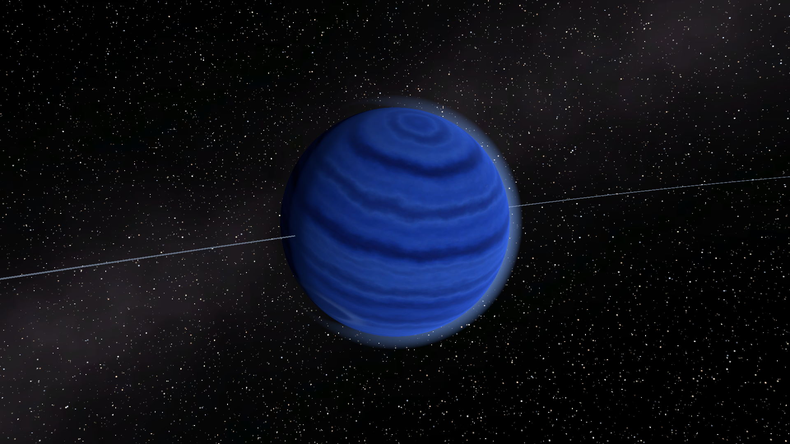
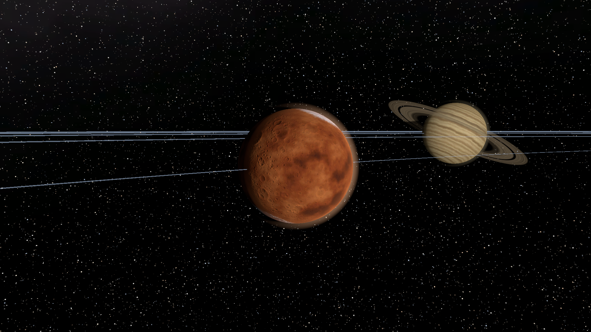
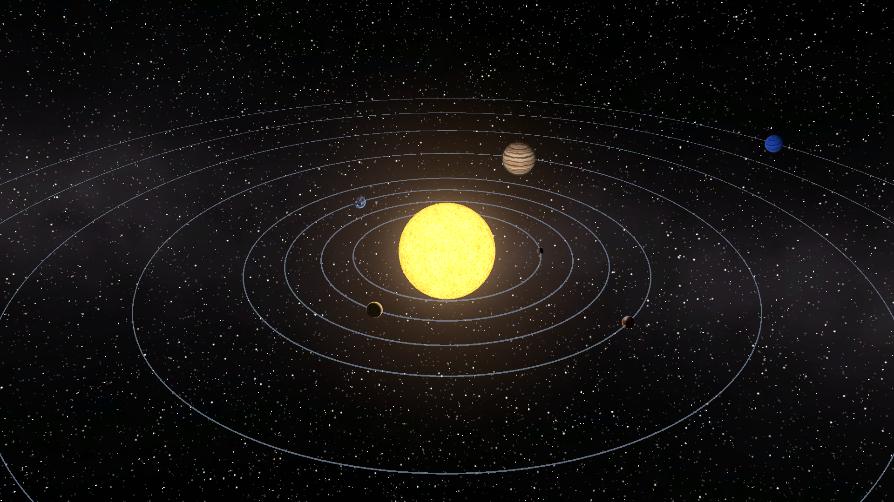

<div align="center">

# 🌌 Interactive Solar System Simulation

### Fly through the Sun, eight planets and the Moon — right in your browser.




**Scroll to zoom from a planet's atmosphere out to the edge of the Solar System.**
**Click a world to fly to it. Fire comets at planets. Toggle the live system map.**

</div>

---

## ✨ Highlights

| | |
|---|---|
| 🔭 **Zoom anywhere** | Scroll wheel, `+` / `-` keys or on-screen buttons zoom smoothly in open space — from skimming a planet to seeing every orbit at once. |
| 🗺️ **Live system map** | A top-down minimap in the bottom-left follows every planet in real time. Hide or show it with the **Show map** toggle or the `M` key (your choice is remembered). |
| 🪐 **Click to explore** | Click any planet (or press `0`–`8`) and the camera glides to its sunlit side while an info panel shows its facts. |
| ☄️ **Fire comets** | Hold `Space` or right-click to shoot glowing comets toward whatever is under your cursor. |
| 🎵 **Ambient soundtrack** | A slow, synthesised space-music loop with pads, sub-bass and bell sparkles. Mute it any time. |
| 🌍 **Rich planets** | Earth has oceans, continents, clouds, an atmosphere and **city lights on the night side**. Saturn's rings **cast and receive shadows**. Jupiter has its Great Red Spot. |

---

## 🖼️ Gallery

<table>
  <tr>
    <td><br><sub><b>Earth &amp; the Moon</b> — clouds, ocean glint, atmosphere</sub></td>
    <td><br><sub><b>Saturn</b> — ring gaps and planet shadow on the rings</sub></td>
  </tr>
  <tr>
    <td><br><sub><b>Jupiter</b> — turbulent cloud bands and the Great Red Spot</sub></td>
    <td><br><sub><b>Neptune</b> — deep-blue ice giant with a storm</sub></td>
  </tr>
  <tr>
    <td><br><sub><b>Mars</b> — craters, dust and polar ice cap</sub></td>
    <td><br><sub><b>The Sun</b> — granulation, glow and the orbit rings</sub></td>
  </tr>
</table>

---

## 🎮 Controls

| Action | Input |
|---|---|
| Zoom in / out | **Mouse wheel**, `+` / `-`, `PageUp` / `PageDown`, or the **+** / **−** buttons |
| Focus a planet | **Left-click** it, or press `0` (Sun) · `1`–`8` (Mercury → Neptune) |
| Orbit the camera | **Click-and-drag** (left or middle mouse button) |
| See the whole system | `Home`, `O`, `Esc`, or the **ALL** button |
| Fire comets | `Space` or **right-click** |
| Show / hide the map | `M` or the **Show map** checkbox |
| Music on / off | **Music** checkbox |

---

## 🛠️ How it's built

This project is a showcase of what you can do in Unity **without importing a single external asset**.

- **Custom HLSL shaders (URP)** – planet lighting with a soft terminator, normal-mapped terrain, ocean specular, night-side city lights, atmospheric limb glow, a billboarded sun corona, cloud shells, ring shadows and a **procedural star sky** that stays razor-sharp at any zoom.
- **Procedural textures** – every planet, normal map, cloud layer, ring strip and the Milky Way is generated from scratch with 3D Perlin noise, Worley (cellular) craters and domain-warped fractals (`Assets/Editor/ProceduralTextures.cs`).
- **Procedural music** – the soundtrack is synthesised in code (`Assets/Editor/MusicGenerator.cs`).
- **Camera rig** – exponential zoom, lag-free target following and automatic framing of the sunlit side of any body (`LookAtTarget.cs`).
- **Post-processing** – HDR bloom, ACES tone-mapping, vignette and colour grading through a URP Volume.
- **WebGL-ready** – URP, Gzip compression with decompression fallback, a custom responsive HTML template and a ~26 MB build.

### Project layout

```
Assets/
 ├─ Scripts/        Runtime code: camera rig, orbits, minimap, UI, comets
 ├─ Shaders/        Custom URP HLSL shaders (planet, sun, glow, rings, clouds, star sky…)
 ├─ Editor/         Procedural texture / music generators and the scene builder
 ├─ Textures/       Generated planet, normal, cloud and sky textures
 ├─ Audio/          Generated ambient soundtrack
 ├─ Materials/      Generated materials
 ├─ Scenes/         SolarSystem.unity (the only scene)
 └─ WebGLTemplates/ Responsive full-window page for the WebGL build
docs/screenshots/   Images used in this README
```

---

## ▶️ Play it

- **In the browser:** [*add your itch.io link here once the game is published.*](https://ashwinzzz.itch.io/solar-system)
- **Locally:** download the WebGL build zip, unzip it, and serve the folder with any local web server (browsers block WebGL pages opened straight from disk). For example, with Node.js:
  ```bash
  npx serve .
  ```

---

## 🧰 Open & build the project

**Requirements:** Unity **6000.6.1f1** with the **WebGL Build Support** module.

1. Clone this repository.
2. Add the folder in **Unity Hub → Add → Add project from disk** and open it.
3. Open `Assets/Scenes/SolarSystem.unity` and press **Play**.

**Rebuild everything from code** — the **Solar System** menu in the editor offers:

1. **Generate Textures And Music** – recreates all textures and the soundtrack.
2. **Build Project And Scene** – recreates materials, the URP asset, the scene, UI and player settings.
3. **Build WebGL** – produces the WebGL player in `Builds/WebGL`.

To publish on itch.io, zip the **contents** of `Builds/WebGL` (so `index.html` is at the root of the zip) and upload it as an HTML5 project.

---

## 📝 Notes

- Sizes and distances are **not to scale** (that would make the planets invisible); orbital speeds are compressed so you can actually watch them move.
- Inspired by a simple Unity solar-system demo; this version was rebuilt from scratch with new code, shaders, textures and music, and extended with zoom, a toggleable minimap, a click-to-focus camera and a WebGL-ready UI.

<div align="center">

**Made with Unity, C# and a lot of noise functions ✨**

</div>
